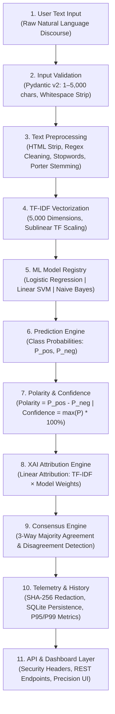

# SENTINEL AI — System Architecture & Technical Specifications

**Platform:** SENTINEL AI — NLP Sentiment Intelligence Platform  
**Target Release:** `v14.3.0-PROD`  
**Core Technologies:** Python 3.11, FastAPI, Pydantic v2, Scikit-Learn 1.3.2, NLTK 3.10, SQLite, Docker  
**Repository:** [sentiment-analysis-nlp-ai](https://github.com/T-Stephen/sentiment-analysis-nlp-ai)

---

## 1. Architectural Overview

SENTINEL AI is designed as a decoupled, modular natural language inference engine. It separates user input sanitization, natural language feature extraction, machine learning classification, mathematical explainability, and persistent telemetry into distinct, auditable pipeline stages.

---

## 2. End-to-End Inference Pipeline

---

## 3. Layer-by-Layer Responsibilities

### Layer 1: User Text Input
- **Responsibility:** Ingests raw user text via HTTP REST endpoints (`/api/v1/predict`, `/api/v1/consensus`) or through the interactive analytical dashboard.
- **Audience Context:** Enables qualitative discourse analysis from customer reviews, surveys, or executive communications.

### Layer 2: Input Validation
- **Responsibility:** Enforces defensive boundary constraints using Pydantic v2.
  - Rejects inputs exceeding 5,000 characters to prevent buffer and memory denial-of-service (DoS).
  - Validates and strips pure whitespace inputs, returning structured HTTP 422 Unprocessable Entity errors.
  - Sanitizes model selection, falling back gracefully to regularized Logistic Regression if an unknown engine string is passed.
- **Audience Context:** Guarantees that invalid or malicious inputs are stopped before reaching computational NLP routines.

### Layer 3: Text Preprocessing
- **Responsibility:** Normalizes unstructured prose into canonical lexical stems:
  1. *HTML Stripping:* Strips tags (`<.*?>`) matching the training corpus cleaning procedure.
  2. *Regex Filtering:* Filters non-alphabet characters (`[^a-zA-Z]`), normalizing word boundaries.
  3. *Case Normalization:* Converts all characters to lowercase.
  4. *Stopword Removal:* Removes non-discriminative grammatical tokens using NLTK English stopwords.
  5. *Morphological Stemming:* Applies algorithmic Porter Stemmer to collapse morphological variants into shared root stems (e.g., `impressive`, `impressed` $\rightarrow$ `impress`).
- **Audience Context:** Ensures strict feature parity with the pre-trained model vocabulary.

### Layer 4: TF-IDF Vectorization
- **Responsibility:** Maps morphological word tokens into a high-dimensional vector space:
  - Uses a pre-fitted 5,000-dimensional sparse vocabulary (`max_features=5000`).
  - Applies sublinear term-frequency scaling to dampen the impact of disproportionately repetitive words.
  - Outputs a sparse Compressed Sparse Row (`scipy.sparse.csr_matrix`) matrix of shape $(1, 5000)$.
- **Audience Context:** Transforms arbitrary text into exact numerical features required for statistical linear algebra.

### Layer 5: ML Model Registry
- **Responsibility:** Houses and manages three pre-trained, production-verified scikit-learn classifiers:
  1. *Logistic Regression v1.0:* Primary L2-regularized linear classifier ($C=1.0$).
  2. *Linear SVM v1.0:* High-margin Linear Support Vector Classifier wrapped with Platt's `CalibratedClassifierCV` (5-fold calibration) to provide authentic posterior probabilities.
  3. *Multinomial Naive Bayes:* Classical generative probabilistic classifier serving as a Bayesian baseline.
- **Audience Context:** Offers multi-model diversity, preventing reliance on a single architectural assumption.

### Layer 6: Prediction Engine
- **Responsibility:** Executes vectorized matrix multiplication to calculate posterior probabilities for positive and negative sentiment classes ($P(\text{Positive}) + P(\text{Negative}) = 1.0$).
- **Audience Context:** Delivers sub-millisecond core inference without external network calls or GPU dependencies.

### Layer 7: Polarity & Confidence Scoring
- **Responsibility:** Translates raw probabilities into standardized business metrics:
  - *Polarity ($\text{AI Score}$):* $P(\text{Positive}) - P(\text{Negative}) \in [-1.0, +1.0]$.
  - *Confidence:* $\max(P(\text{Positive}), P(\text{Negative})) \times 100\% \in [50.0\%, 100.0\%]$.
  - *Affective State Heuristic:* Combines numerical polarity with lexical keyword matching to categorize the affective state (*Joy / High Satisfaction*, *Optimism*, *Anger / Frustration*, *Critical / Discontent*, *Balanced Neutral*).
- **Audience Context:** Provides clear, calibrated executive metrics alongside high-resolution probabilities.

### Layer 8: XAI Attribution Engine
- **Responsibility:** Derives exact, non-stochastic token-level explanations directly from model weights:
  $$\text{Attribution}(i) = \text{TF-IDF}(i) \times w_i$$
  - Decomposes the decision score into **Positive Drivers** ($w_i > 0$) and **Negative Drivers** ($w_i < 0$).
  - Does not rely on sampling-based or heuristic approximations (such as LIME or SHAP).
- **Audience Context:** Eliminates the "black-box" dilemma by showing auditors precisely which words caused the classification.

### Layer 9: Consensus Engine
- **Responsibility:** Executes all three model architectures concurrently against the same input:
  - Aggregates individual classifications and computes majority consensus sentiment.
  - Determines the exact agreement ratio (e.g., `3 / 3 models agree`).
  - Raises an explicit `disagreement_detected = true` flag whenever models split.
- **Audience Context:** Alerts analysts to borderline or ambiguous discourse where model consensus diverges.

### Layer 10: Telemetry & History Storage
- **Responsibility:** Records inference records to an indexed SQLite database (`sentinel.db`):
  - *Privacy Redaction:* Hashes raw input text with SHA-256 (`[REDACTED] - SHA256:<hash>`) by default.
  - *Telemetry:* Tracks inference latency, correlation `request_id` (`SN-<8-hex>`), sentiment, confidence, and engine name.
  - *Auditor Feedback:* Supports human verification updates (`Confirmed` / `Flagged Incorrect`).
  - *Percentile Metrics:* Dynamically calculates P95 and P99 latency percentiles over historical runs.
- **Audience Context:** Provides complete compliance audit trails without storing sensitive text.

### Layer 11: API Gateway & Analytical Dashboard
- **Responsibility:** Exposes RESTful endpoints and serves the client interface:
  - Injects defense-in-depth HTTP security headers (`X-Request-ID`, `X-Content-Type-Options`, `X-Frame-Options`, `Content-Security-Policy`).
  - Delivers streaming RFC-4180 CSV and JSON data exports.
  - Renders the Precision Intelligence Terminal dashboard (HTML5, CSS3, Vanilla JS) featuring responsive desktop tables, mobile stacked cards, and collapsible forensic inspection drawers.
- **Audience Context:** Provides an auditable, lightweight, and responsive interface for technical reviewers and executives alike.

---

## 4. Hardware & Scaling Characteristics
- **Memory Footprint:** Under 150 MB RAM for the complete ASGI service, including all 3 serialized models and TF-IDF vocabulary.
- **Latency Profile:** Sub-millisecond core model matrix evaluation; typical end-to-end local HTTP response time $<15$ ms.
- **Concurrency Model:** Asynchronous ASGI event loop (Uvicorn / Starlette) with thread-isolated SQLite connections.
- **Horizontal Scaling Path:** SQLite persistence can be swapped for a centralized PostgreSQL cluster by configuring a connection string environment variable for multi-worker container deployments.
