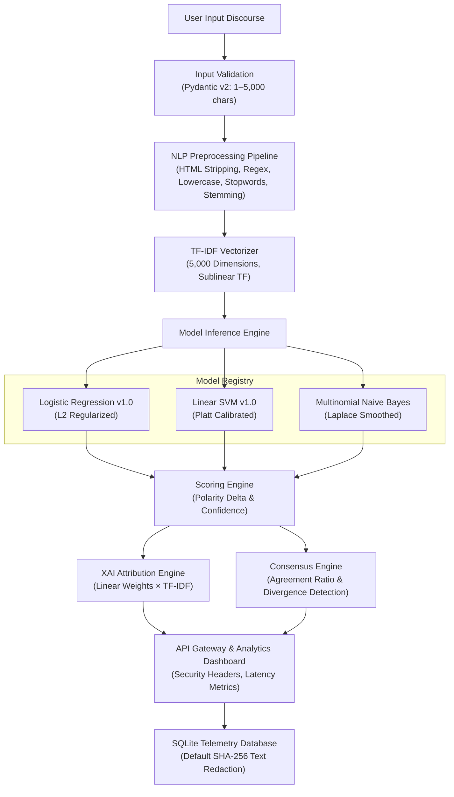

# SENTINEL AI — NLP Sentiment Intelligence Platform

[](https://www.python.org/)
[](https://fastapi.tiangolo.com/)
[](https://scikit-learn.org/)
[](#14-automated-testing--verification)
[](https://www.docker.com/)
[](LICENSE)
[](https://github.com/T-Stephen/sentiment-analysis-nlp-ai)
[](https://sentinel-nlp-intelligence.onrender.com/)

> **Academic Topic:** NLP Project: Sentiment Analysis (AI + Text Processing)
> **Repository:** [sentiment-analysis-nlp-ai](https://github.com/T-Stephen/sentiment-analysis-nlp-ai)
> **Live Deployment:** [sentinel-nlp-intelligence.onrender.com](https://sentinel-nlp-intelligence.onrender.com/)
> **Release:** `v14.3.0-PROD`
> **Classification:** Classical ML Sentiment Intelligence Platform / Analytical Research Terminal

---

## 1. Title and Product Description

**SENTINEL AI** is a production-hardened, privacy-conscious Natural Language Processing (NLP) sentiment intelligence platform. Engineered as a high-throughput analytical terminal, it provides deterministic sentiment classification, multi-model consensus verification, and mathematical feature attribution without external cloud API dependencies.

Built on classical machine learning foundations, SENTINEL AI demonstrates that regularized linear models paired with domain-aligned feature engineering can deliver low-latency inference, full statistical transparency, and defensible auditability for enterprise and academic workflows.

---

## 2. Technology Badges

The platform components and operational status are reflected by the verified badges below:

- **Runtime & Frameworks:** Python 3.11 | FastAPI 0.104.1 | Scikit-Learn 1.3.2
- **Quality Assurance:** 34/34 Passing Unit & Integration Tests (see [Section 14](#14-automated-testing--verification))
- **Deployment & Packaging:** Docker Ready | Containerized microservice
- **Governance & Licensing:** Open-source under the MIT License
- **Live Cloud Deployment:** Publicly available on Render Free Tier

---

## 3. Live Demo and Repository Links

- **Repository:** [https://github.com/T-Stephen/sentiment-analysis-nlp-ai](https://github.com/T-Stephen/sentiment-analysis-nlp-ai)
- **Live Application:** [Open application](https://sentinel-nlp-intelligence.onrender.com/)
- **Live Health Endpoint:** [View health endpoint](https://sentinel-nlp-intelligence.onrender.com/health)
- **Live OpenAPI Documentation:** [OpenAPI docs](https://sentinel-nlp-intelligence.onrender.com/docs)

> **Hosting Operational Notes (Render Free Tier):**
> - **Cold Starts:** Hosted on Render's Free tier, the web service automatically spins down after periods of inactivity. An initial request may encounter a cold start delay of 15–30 seconds while the runtime initializes and model artifacts load into memory.
> - **Ephemeral Storage:** Telemetry records stored in SQLite (`data/sentinel.db`) are ephemeral and reset upon container restarts or redeployments. Serialized model binaries and application code remain permanently tracked in Git version control.
> - **Observed Health Verification:** The root health check (`/health`) was verified operational with `status: healthy`, active database connectivity, and all three models plus the TF-IDF vectorizer loaded.

---

## 4. Analytical Dashboard Interface

<!-- OPTIONAL SCREENSHOT: Insert terminal dashboard screenshot here -->

The user interface is designed as an analytical terminal styled in deep obsidian (`#07080B`) with subtle brass accents, providing:
- Real-time single-model inference and multi-model consensus controls.
- Dynamic Explainable AI (XAI) feature attribution driver bars.
- Live telemetry monitoring with P95/P99 latency calculations.
- Human-in-the-loop audit verification controls (`Confirmed` / `Flagged Incorrect`).
- Dual-mode responsiveness: full forensic desktop telemetry table and mobile stacked intelligence cards with collapsible drawers.

---

## 5. Executive Summary & Problem Statement

In enterprise compliance, customer intelligence, and academic research, processing qualitative natural language discourse presents three persistent challenges:

1. **The Black-Box Opacity Problem:** Deep neural architectures and third-party LLMs rarely provide transparent, deterministic explanations for specific sentiment classifications, creating compliance hurdles in auditable environments.
2. **Model Fragility & Single-Engine Bias:** Individual machine learning models can exhibit edge-case fragility when processing ambiguous or borderline discourse.
3. **Data Governance & Exfiltration Risks:** Transmitting sensitive internal communications or proprietary customer feedback to external commercial APIs exposes organizations to privacy violations and intellectual property leakage.

**SENTINEL AI addresses these challenges directly by providing:**
- Fully offline, local inference using pinned Scikit-Learn classifiers.
- Exact, deterministic feature attribution derived from linear model mathematics.
- Epistemic multi-model consensus resolution to flag borderline classifications.
- Privacy-by-design SHA-256 text redaction prior to database persistence.

---

## 6. Key Features & Project Scope

- **Three-Engine Model Registry:**
  - **Logistic Regression v1.0:** Primary production classifier with L2 regularization ($C=1.0$).
  - **Linear SVM v1.0:** High-margin classifier calibrated via 5-fold Platt sigmoid scaling.
  - **Multinomial Naive Bayes:** Probabilistic baseline model with Laplace smoothing ($\alpha=1.0$).
- **Multi-Model Consensus Resolution (`POST /api/v1/consensus`):** Concurrent multi-engine inference that calculates agreement ratios and automatically flags model divergence.
- **Explainable AI (XAI) Feature Attribution:** Deterministic calculation of token-level contributions ($w_i \times \text{TF-IDF}_i$) rendering positive and negative driver bars.
- **Calibrated Scoring Architecture:** Normalized polarity delta ($\text{AI Score} \in [-1.0, +1.0]$) paired with empirical classification confidence ($[50.0\%, 100.0\%]$).
- **Affective State Heuristics:** Deterministic mapping of lexical polarity and sentiment to cognitive emotional indicators (*Joy / High Satisfaction*, *Optimism*, *Anger / Frustration*, *Critical / Discontent*, or *Balanced Neutral*).
- **Privacy-by-Design Architecture:** Incoming natural language text is hashed via cryptographic SHA-256 prior to persistence (`STORE_RAW_TEXT=False` default). The `/api/v1/history` endpoint strictly excludes raw text from SQL queries.
- **Telemetry & Human Auditor Governance:** Latency profiling (P95/P99), sentiment distribution analytics, and human feedback auditing (`POST /api/v1/feedback`).
- **Data Portability:** Streaming in-memory RFC-4180 CSV and structured JSON exports (`/api/v1/export/csv`, `/api/v1/export/json`).

---

## 7. System Architecture

The microservice architecture decouples input validation, NLP feature extraction, model inference, and audit logging into a single cohesive, low-latency pipeline:



---

## 8. Technology Stack

| Layer | Component | Version | Role |
| :--- | :--- | :--- | :--- |
| **Runtime** | Python | `3.11` | Core execution environment |
| **API Framework** | FastAPI | `0.104.1` | High-performance asynchronous REST API framework |
| **Validation** | Pydantic | `2.5.2` | Strict request/response schema modeling and boundary enforcement |
| **ASGI Server** | Uvicorn | `0.24.0.post1` | Lightweight, asynchronous server implementation |
| **Machine Learning** | Scikit-Learn | `1.3.2` | Model training, calibration, and inference pipelines |
| **NLP Processing** | NLTK | `3.8.1` | Stopword removal and Porter Stemmer morphological reduction |
| **Numerical Computing** | NumPy / SciPy | `1.26.2` / `1.11.4` | Matrix computations and sparse linear algebra |
| **Database** | SQLite3 | Native | Zero-dependency transactional telemetry and audit storage |
| **Testing** | Pytest | `7.4.3` | Comprehensive 34-test automated verification suite |
| **Containerization** | Docker | Engine 20+ | Multi-stage production container deployment |

---

## 9. Dataset & Experimental Methodology

- **Source Corpus:** IMDb Large Movie Review Dataset ([Andrew L. Maas et al., Stanford University](https://ai.stanford.edu/~amaas/data/sentiment/)).
- **Corpus Volume:** 50,000 balanced, highly polarized natural language reviews (25,000 positive, 25,000 negative).
- **Split Configuration:** 80% training partition (40,000 samples) and 20% independent holdout test partition (10,000 samples).
- **Reproducibility Seed:** Fixed pseudo-random seed `42` applied across all dataset splits and estimators.
- **Corpus Exclusion:** In accordance with open-source hygiene, the raw 66.2 MB dataset (`data/IMDB Dataset.csv`) is excluded from Git tracking via `.gitignore`.
- **Text Preprocessing Pipeline:**
  1. *HTML Strip:* Removal of markup tags (`<.*?>`) preserving underlying textual discourse.
  2. *Character Normalization:* Filtering non-alphabetic characters (`[^a-zA-Z]`) and whitespace standardization.
  3. *Case Folding:* Conversion of all tokens to lowercase.
  4. *Stopword Filtering:* Removal of non-informative grammatical tokens via NLTK English stopword lexicon.
  5. *Morphological Stemming:* Algorithmic reduction to morphological roots using the Porter Stemmer.
- **Feature Extraction:**
  - Fitted `TfidfVectorizer` configured with 5,000 maximum unigram features (`max_features=5000`, `ngram_range=(1, 1)`).
  - Sublinear term frequency scaling applied: $\text{TF-IDF}(t, d) = \text{TF}(t, d) \times (\log \frac{1 + N}{1 + \text{DF}(t)} + 1)$.

---

## 10. Model Comparison & Verified Benchmarks

The machine learning models were evaluated on the independent **10,000-sample holdout test partition** ($N=10,000$, 4,961 actual negatives, 5,039 actual positives). All metrics below are verified directly against `artifacts/benchmark/model_metrics.json`:

| Model Engine | Model Family | Accuracy | Precision | Recall | F1-Score | ROC-AUC | Status |
| :--- | :--- | :---: | :---: | :---: | :---: | :---: | :---: |
| **Logistic Regression v1.0** | Generalized Linear Model (L2) | **88.55%** | **0.8747** | **0.9020** | **0.8881** | **0.9571** | **Active Production** |
| **Linear SVM v1.0** | Calibrated Support Vector Classifier | **88.40%** | **0.8751** | **0.8980** | **0.8864** | **0.9534** | **Ensemble Ready** |
| **Multinomial Naive Bayes** | Probabilistic Bayes (Laplace) | **85.10%** | **0.8471** | **0.8595** | **0.8532** | **0.9255** | **Baseline** |

### Verified Test Partition Confusion Matrix (Logistic Regression, N=10,000)

| Classification | Predicted Negative | Predicted Positive | Total Actual |
| :--- | :---: | :---: | :---: |
| **Actual Negative** | **TN = 4,310** (86.88%) | **FP = 651** (Type I Error) | 4,961 |
| **Actual Positive** | **FN = 494** (Type II Error) | **TP = 4,545** (90.20%) | 5,039 |
| **Total Predicted** | **4,804** | **5,196** | **10,000** |

$$\text{Accuracy} = \frac{4310 + 4545}{10000} = 88.55\% \quad \Big| \quad \text{Precision} = \frac{4545}{5196} \approx 0.8747 \quad \Big| \quad \text{Recall} = \frac{4545}{5039} \approx 0.9020$$

---

## 11. Prediction Methodology & Explainability Limitations

### Mathematical Scoring Workflow
For an incoming input text:
1. **Class Probabilities:** The selected model outputs posterior probabilities $P(\text{Negative})$ and $P(\text{Positive})$ where $P(\text{Negative}) + P(\text{Positive}) = 1.0$.
2. **Polarity Delta (AI Score):**
   $$\text{Polarity} = P(\text{Positive}) - P(\text{Negative}) \in [-1.0, +1.0]$$
3. **Confidence Level:**
   $$\text{Confidence} = \max(P(\text{Positive}), P(\text{Negative})) \times 100\% \in [50.0\%, 100.0\%]$$
4. **Classification Thresholds:**
   - $\text{Polarity} \ge +0.10 \implies \text{Positive}$
   - $\text{Polarity} \le -0.10 \implies \text{Negative}$
   - $-0.10 < \text{Polarity} < +0.10 \implies \text{Neutral}$ (Low-margin / Indeterminate)
5. **Affective Heuristic State:** Deterministic heuristic mapping based on polarity and sentiment:
   - Positive + high confidence $\rightarrow$ *Joy / High Satisfaction*
   - Positive + moderate confidence $\rightarrow$ *Optimism*
   - Negative + high confidence $\rightarrow$ *Anger / Frustration*
   - Negative + moderate confidence $\rightarrow$ *Critical / Discontent*
   - Neutral boundary $\rightarrow$ *Balanced Neutral*

### Explainable AI (XAI) Attribution
Feature attribution is computed deterministically from model linear weights without stochastic sampling approximations:

$$\text{Attribution}(i) = \text{TF-IDF}(i) \times w_i$$

Where feature weight $w_i$ is derived by model architecture:
- **Logistic Regression:** $w_i = \text{coef\_}[0][i]$
- **Linear SVM:** $w_i = \frac{1}{K} \sum_{k=1}^K \text{coef\_}^{(k)}[i]$ averaged across calibrated base estimators
- **Multinomial Naive Bayes:** $w_i = \log P(x_i \mid \text{Pos}) - \log P(x_i \mid \text{Neg})$ (Weight of Evidence)

> **Explainability Limitations:** Feature attribution scores reflect linear mathematical correlations with respect to the learned decision hyperplane. They do not represent causal relationships, semantic discourse comprehension, or contextual transformer attention.

---

## 12. API Endpoint Reference

All endpoints are implemented in [`app.py`](app.py) and adhere to Pydantic v2 validation boundaries:

| Method | Endpoint | Description | Request Payload / Params | Response Status |
| :--- | :--- | :--- | :--- | :---: |
| `GET` | `/` | Analytical Terminal UI | None | `200 OK` |
| `GET` | `/health` | Core system health check | None | `200 OK` |
| `GET` | `/api/v1/health` | Standardized versioned health endpoint | None | `200 OK` |
| `GET` | `/api/v1/models` | Metadata and benchmark metrics for all models | None | `200 OK` |
| `POST` | `/api/v1/predict` | Single-engine sentiment classification & XAI drivers | `{"text": str, "model_choice": str}` | `200 OK` |
| `POST` | `/api/v1/consensus` | Multi-engine concurrent consensus & divergence analysis | `{"text": str}` | `200 OK` |
| `POST` | `/api/v1/feedback` | Records auditor verification (`Confirmed` / `Flagged`) | `{"request_id": str, "feedback_state": str}` | `200 OK` |
| `GET` | `/api/v1/analytics` | Telemetry summary, latency percentiles (P95/P99) | None | `200 OK` |
| `GET` | `/api/v1/history` | Chronological audit logs (Redacted text by default) | None (limit 50) | `200 OK` |
| `GET` | `/api/v1/export/csv` | Streams database audit logs as RFC-4180 CSV attachment | None | `200 OK` |
| `GET` | `/api/v1/export/json` | Streams database audit logs as structured JSON dump | None | `200 OK` |
| `GET` | `/docs` | Interactive Swagger UI API documentation | None | `200 OK` |
| `GET` | `/redoc` | Interactive ReDoc API documentation | None | `200 OK` |

### Sample cURL Requests

**Single Model Inference (`POST /api/v1/predict`):**
```bash
curl -X POST http://localhost:8000/api/v1/predict \
  -H "Content-Type: application/json" \
  -d '{
    "text": "The strategic execution demonstrated exceptional resilience and clarity.",
    "model_choice": "logistic_regression"
  }'
```

**Multi-Model Consensus (`POST /api/v1/consensus`):**
```bash
curl -X POST http://localhost:8000/api/v1/consensus \
  -H "Content-Type: application/json" \
  -d '{
    "text": "The quarterly operational review highlighted significant organizational discipline."
  }'
```

---

## 13. Local Installation & Execution

### Prerequisites
- Python 3.11+
- Git

### Installation Steps

```bash
# 1. Clone repository
git clone https://github.com/T-Stephen/sentiment-analysis-nlp-ai.git
cd sentiment-analysis-nlp-ai

# 2. Create a virtual environment
python -m venv .venv
```

**Activate Virtual Environment:**

- **On Windows (PowerShell):**
  ```powershell
  .\.venv\Scripts\Activate.ps1
  ```
- **On Linux / macOS (Bash/Zsh):**
  ```bash
  source .venv/bin/activate
  ```

**Install Dependencies & Launch Service:**

```bash
# 3. Install pinned dependencies
pip install -r requirements.txt

# 4. Run automated test suite
pytest -q

# 5. Launch local analytical service
uvicorn app:app --host 0.0.0.0 --port 8000
```
Open your web browser and navigate to `http://localhost:8000` to access the terminal dashboard.

---

## 14. Automated Testing & Verification

The repository contains an automated 34-test regression test suite in the `tests/` directory covering data validation, preprocessing, model loading, single and consensus predictions, explainability math, error handling, telemetry, and exports:

```bash
# Run test suite quietly
pytest -q

# Run with verbose test reporting
pytest -v
```

### Verified Test Result
- **Reported Local Baseline:** `34 passed, 1 warning in 13.92s`
- **Warning Detail:** Harmless deprecation warning in third-party NLTK regex compilation (`DeprecationWarning: Flags not at the start of the expression '(\\?#[^)]*)'`).
- **Test Modules:**
  - `test_validation.py`: Pydantic length bounds (1–5,000 characters), empty string rejection, whitespace validation.
  - `test_preprocessing.py`: HTML stripping, regex filtering, stopword elimination, Porter stemming.
  - `test_models.py`: Model serialization integrity, registry loading, class label consistency.
  - `test_prediction.py`: Single-model inference, probability sums ($P=1.0$), score bounds, consensus unanimity and divergence.
  - `test_xai.py`: Exact attribution formula calculations ($w_i \times \text{TF-IDF}_i$), positive and negative driver separation.
  - `test_errors.py`: Malformed JSON handling, unhandled route responses, health check verification.
  - `test_feedback.py`: Telemetry auditor updates (`Confirmed`, `Flagged Incorrect`), unknown request ID rejection.
  - `test_analytics.py`: Real-time analytics aggregation, P95/P99 latency math, distribution accounting.
  - `test_exports.py`: In-memory RFC-4180 CSV and JSON stream generation without disk leaks.
  - `test_api.py`: Baseline regression tests and legacy route compatibility.

---

## 15. Docker Container Deployment

The application includes a production-grade [`Dockerfile`](Dockerfile) and [`docker-compose.yml`](docker-compose.yml) based on `python:3.11-slim` with offline NLTK corpora pre-downloaded to eliminate runtime internet dependencies:

```bash
# Build and launch the containerized service
docker compose up --build -d

# Verify container health
curl -f http://localhost:8000/health

# Inspect live container logs
docker compose logs -f

# Terminate container service
docker compose down
```

---

## 16. Privacy, Security Controls & Governance

### Privacy Architecture
- **Default Raw-Text Redaction (`STORE_RAW_TEXT=False`):** Text discourse is never saved in plaintext by default. Instead, it is hashed using SHA-256 before insertion into SQLite:
  $$\text{Stored Record} = \text{"[REDACTED] - SHA256:"} + \text{SHA256}(\text{Text})$$
- **History Isolation:** The `/api/v1/history` endpoint executes an explicit SQL query excluding the raw text column, preventing textual data leakage in client session state.
- **In-Memory Streaming:** Telemetry exports (`/api/v1/export/csv`, `/api/v1/export/json`) are assembled in-memory using `io.StringIO` and streamed directly to the client without temporary file creation.

### Application Security Controls
- **Input Boundaries:** Pydantic v2 schemas reject text exceeding 5,000 characters and reject whitespace-only strings with HTTP 422.
- **SQL Injection Defense:** 100% of SQLite database operations utilize parameterized queries with `?` parameter substitution.
- **HTTP Security Headers:** Injected by `SecurityAndObservabilityMiddleware` on all responses:
  - `X-Content-Type-Options: nosniff`
  - `X-Frame-Options: DENY`
  - `X-XSS-Protection: 1; mode=block`
  - `Referrer-Policy: strict-origin-when-cross-origin`
  - `Permissions-Policy: geolocation=(), camera=(), microphone=()`
  - `Content-Security-Policy`: Restricts scripts, styles, and fonts to `self` and specified CDNs.
  - `X-Request-ID`: Unique correlation tracing UUID header assigned to every request.

### Operational Security Boundaries
- **Transport Security:** HTTP-level headers are enforced in-application. TLS termination, certificate management, and HSTS headers are deferred to the production reverse proxy or hosting provider (e.g. Render edge gateway).
- **Security Limitations:** Security defenses mitigate common application vulnerabilities (e.g. injection, MIME sniffing, framing). SENTINEL AI does not make absolute claims of zero-vulnerability guarantees.

---

## 17. Known Limitations & Future Improvements

### Technical & Analytical Boundaries
- **Domain Distribution Shift:** Models are trained on narrative cinematic reviews. While general lexical polarity generalizes well, distribution shifts may occur when analyzing specialized domains (such as legal contracts, clinical notes, or financial disclosures).
- **Language Boundary:** The preprocessing pipeline is tailored for the English language; non-English discourse is filtered by the regex stage.
- **Complex Negation & Sarcasm:** As linear bag-of-words models using unigrams, the models may misinterpret subtle sarcasm, double negatives, or complex rhetorical irony.
- **Database Scalability:** SQLite is optimized for single-worker instances and local analytical workloads. High-concurrency enterprise deployments should transition to PostgreSQL or MySQL.
- **Hosting Constraints (Render Free Tier):** Inactivity triggers runtime spin-down causing 15–30 second cold starts, and container storage is ephemeral between redeployments.

### Planned Enhancements
- **Domain Adaptation:** Fine-tuned domain vocabularies for financial and customer service text.
- **Sub-word Tokenization:** Optional Byte-Pair Encoding (BPE) fallback to handle out-of-vocabulary terms.
- **Enterprise Persistence:** Pluggable PostgreSQL database backend for multi-worker container scaling.
- **Continuous Integration:** GitHub Actions matrix workflow running automated tests across Python 3.10, 3.11, and 3.12.

---

## 18. License, Attribution & Author Information

### License
This project is open-sourced under the **MIT License**. See the [LICENSE](LICENSE) file for complete terms.

### Dataset & Third-Party Attribution
- **IMDb Large Movie Review Dataset:** Provided for scientific research and education by Andrew L. Maas et al., Stanford University (2011).
- **Open-Source Libraries:** Scikit-Learn (BSD-3-Clause), FastAPI (MIT), NLTK (Apache 2.0), Pydantic (MIT), Uvicorn (BSD-3-Clause).

### Author & Repository Metadata
- **Author:** **T-Stephen**
- **GitHub Profile:** [@T-Stephen](https://github.com/T-Stephen)
- **Repository:** [sentiment-analysis-nlp-ai](https://github.com/T-Stephen/sentiment-analysis-nlp-ai)
- **Live Deployment:** [sentinel-nlp-intelligence.onrender.com](https://sentinel-nlp-intelligence.onrender.com/)
